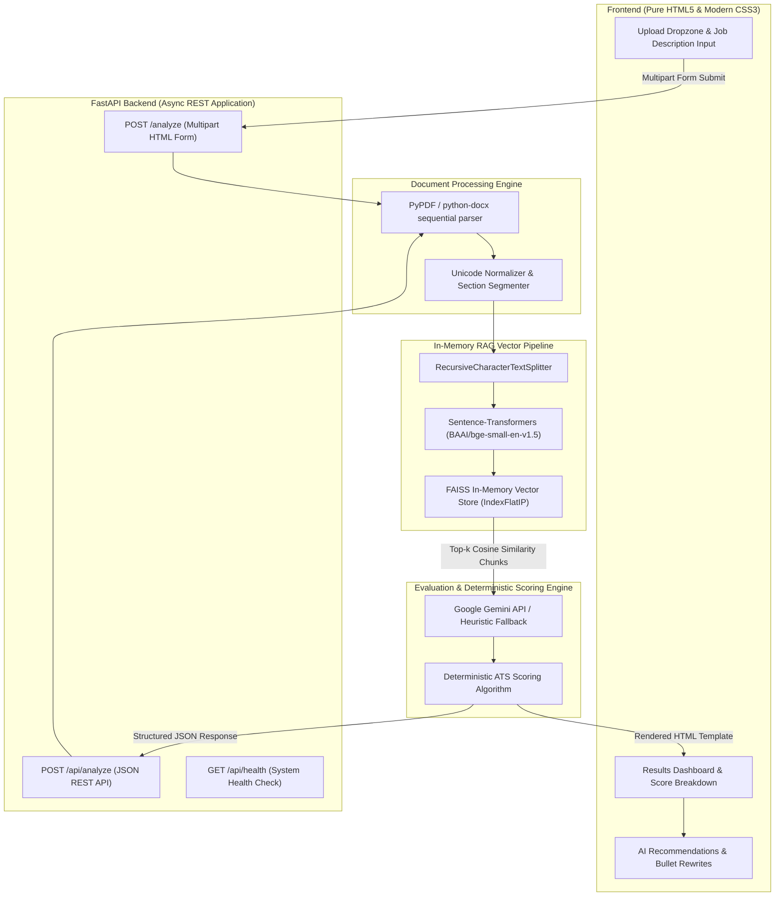

# ResumeIQ 🎯

> **Tagline:** *Optimize your resume. Match your dream job.*

ResumeIQ is an AI-powered Resume Analyzer that evaluates how well a candidate's resume aligns with a target job description. Combining **Retrieval-Augmented Generation (RAG)** using dense semantic vector search with a **deterministic mathematical ATS scoring engine**, ResumeIQ provides actionable, evidence-grounded feedback and bullet point rewrites without hallucinating facts.

---

## 🌟 Key Features

- 📄 **Multi-Format Ingestion:** High-fidelity parsing of `.pdf` and `.docx` resumes with structured section segmentation (Summary, Skills, Experience, Projects, Education).
- 🧠 **Retrieval-Augmented Generation (RAG):** Recursive semantic chunking indexed in an in-memory FAISS flat inner-product vector store using Sentence Transformers (`BAAI/bge-small-en-v1.5`).
- ⚖️ **Deterministic Weighted ATS Scoring:** Strict Python-calculated formula (0–100%) preventing LLM hallucination or arbitrary score drift across 5 core dimensions.
- ✍️ **Evidence-Grounded Bullet Rewriting:** Rewrites weak experience bullets into high-impact, metrics-driven achievements following Google's X-Y-Z formula using existing resume evidence only.
- 🎨 **Pure HTML5 + Modern CSS3 Frontend:** 100% framework-free, zero-JavaScript design with pure semantic markup, Jinja2 template rendering, and responsive typography.
- ⚡ **Stateless & Lightweight:** No database setup, migrations, or local DB management required. Vector embeddings and semantic searches run efficiently in memory per analysis request.
- 🛡️ **Dual-Mode AI Engine:** Seamlessly transitions between live Google Gemini LLM analysis and an intelligent offline heuristic fallback for development and testing.

---

## 📐 System Architecture



---

## 🧮 Deterministic ATS Scoring Methodology

ResumeIQ calculates the overall compatibility score using a strict, auditable weighted mathematical model:

$$\text{Overall ATS Score} = \sum (W_i \times S_i)$$

| Dimension | Weight ($W_i$) | Methodology |
|---|:---:|---|
| **Technical Skills Match** | 30% | $\frac{\text{Skills Identified in Resume}}{\text{Total Critical Technical Skills in JD}} \times 100$ |
| **Experience Relevance** | 25% | Semantic alignment between candidate's work history and job responsibilities. |
| **Project Relevance** | 20% | Similarity of technical projects, tooling, and architectures to target role. |
| **Keyword Match** | 15% | Density and distribution of key domain terms across resume sections. |
| **Education & Certifications** | 10% | Alignment with required degrees, certifications, or specialized licenses. |

### Verdict Thresholds
- 🟢 **Strong Match:** $\ge 75\%$
- 🟡 **Moderate Match:** $50\% - 74\%$
- 🔴 **Needs Optimization:** $< 50\%$

---

## 📁 Clean Project Structure

```text
webd/
├── backend/
│   ├── app/
│   │   ├── api/
│   │   │   ├── routes_analyze.py    # POST /api/analyze REST endpoint
│   │   │   ├── schemas.py           # Strict Pydantic contracts & response models
│   │   │   └── __init__.py
│   │   ├── core/
│   │   │   ├── scoring.py           # Deterministic weighted ATS scoring engine
│   │   │   ├── text_cleaner.py      # Unicode normalization & regex section parser
│   │   │   └── __init__.py
│   │   ├── services/
│   │   │   ├── llm_service.py       # Google Gemini LLM & offline heuristic fallback
│   │   │   ├── parser_service.py    # PyPDF & python-docx extraction engine
│   │   │   ├── rag_service.py       # SentenceTransformers, FAISS vector index & RAG
│   │   │   └── __init__.py
│   │   ├── config.py                # Pydantic Settings & environment config
│   │   ├── main.py                  # FastAPI application entrypoint & form routing
│   │   └── __init__.py
│   ├── tests/
│   │   ├── test_api_analyze.py      # End-to-end API integration tests
│   │   ├── test_edge_cases.py       # Resilience & file boundary condition tests
│   │   ├── test_health.py           # Server health & environment config tests
│   │   ├── test_parser.py           # PDF/DOCX parsing & text normalization tests
│   │   ├── test_rag.py              # Semantic chunking & FAISS retrieval tests
│   │   ├── test_scoring.py          # Deterministic mathematical score tests
│   │   └── __init__.py
│   └── __init__.py
├── frontend/
│   ├── assets/
│   │   ├── css/
│   │   │   └── index.css            # Production stylesheet with custom properties
│   │   └── favicon.png              # ResumeIQ brand icon
│   └── index.html                   # Semantic HTML5 template with Jinja2 rendering
├── .env.example                     # Environment template
├── .gitignore                       # Git ignore rules
├── README.md                        # Documentation
└── requirements.txt                 # Python project dependencies
```

---

## 🚀 Quickstart Guide

### 1. Prerequisites
- Python 3.10+ (tested with Python 3.11, 3.12, 3.13)
- pip package manager

### 2. Clone and Setup Environment
```bash
git clone <repository-url>
cd webd

# Create virtual environment (optional but recommended)
python -m venv venv
# Windows:
venv\Scripts\activate
# Linux/macOS:
source venv/bin/activate

# Install dependencies
pip install -r requirements.txt
```

### 3. Environment Configuration
Copy `.env.example` to `.env`:
```bash
cp .env.example .env
```

Edit `.env` with your settings:
```ini
APP_ENV=development
APP_NAME=ResumeIQ
DEBUG=True
PORT=8000
HOST=127.0.0.1
CORS_ORIGINS=http://localhost:3000,http://localhost:5500,http://127.0.0.1:5500,http://127.0.0.1:8000

# Google Gemini API Key (Optional: system uses intelligent heuristic fallback if unset)
GEMINI_API_KEY=your_gemini_api_key_here

# Embedding Model (Hugging Face / Sentence-Transformers)
EMBEDDING_MODEL_NAME=BAAI/bge-small-en-v1.5
```

### 4. Run the Application
```bash
python -m uvicorn backend.app.main:app --host 127.0.0.1 --port 8000 --reload
```

- **Web Application:** Open [http://127.0.0.1:8000/](http://127.0.0.1:8000/) in your browser.
- **Interactive API Docs (Swagger UI):** [http://127.0.0.1:8000/docs](http://127.0.0.1:8000/docs)
- **ReDoc:** [http://127.0.0.1:8000/redoc](http://127.0.0.1:8000/redoc)

---

## 🔌 API Reference

### 1. Analyze Resume (`POST /api/analyze`)
Uploads a resume file and job description, returning a full JSON analysis.

**Request:** `multipart/form-data`
- `file`: Resume document (`.pdf` or `.docx`, max 10MB)
- `job_description`: Target job description text (min 20 characters)

**Response (`200 OK`):**
```json
{
  "id": "a1b2c3d4e5f6",
  "timestamp": "2026-11-15T12:00:00Z",
  "filename": "Jordan_Lee_Resume.pdf",
  "target_role": "Senior Full-Stack Engineer",
  "score_breakdown": {
    "technical_skills_score": 91.0,
    "experience_relevance_score": 88.0,
    "project_relevance_score": 75.0,
    "keyword_match_score": 86.0,
    "education_score": 93.0,
    "overall_ats_score": 87.2,
    "verdict": "Strong Match"
  },
  "matched_skills": [
    {
      "name": "Python",
      "category": "hard_skill",
      "status": "matched",
      "evidence": "Engineered microservices using Python and FastAPI"
    }
  ],
  "missing_skills": [
    {
      "name": "Kubernetes",
      "category": "hard_skill",
      "status": "missing",
      "evidence": null
    }
  ],
  "bullet_improvements": [
    {
      "original": "Led the redesign of the onboarding experience.",
      "improved": "Led an end-to-end onboarding redesign that increased activation by 24% and reduced time-to-value by 31%.",
      "critique": "Replaces passive description with active accomplishment verb and measurable impact metrics."
    }
  ],
  "experience_critique": "Your resume demonstrates strong alignment with backend requirements...",
  "projects_critique": "Projects show solid application of relevant tech stack...",
  "actionable_recommendations": [
    "Highlight specific metrics around microservice throughput and latency improvements.",
    "Incorporate container orchestration keywords directly into experience bullets."
  ],
  "word_count": 482,
  "page_count": 1
}
```

### 2. Web Form Submit (`POST /analyze`)
Standard HTML form submission route rendering the dynamic Jinja2 results dashboard.

### 3. System Health Check (`GET /api/health`)
Returns real-time status and configuration health.

---

## 🧪 Testing & Validation

The codebase includes comprehensive automated tests covering document parsing, deterministic scoring, RAG vector retrieval, and HTTP API integration.

To execute the test suite:
```bash
pytest backend/tests/ -v
```

---

## 📄 License
This project is licensed under the MIT License.